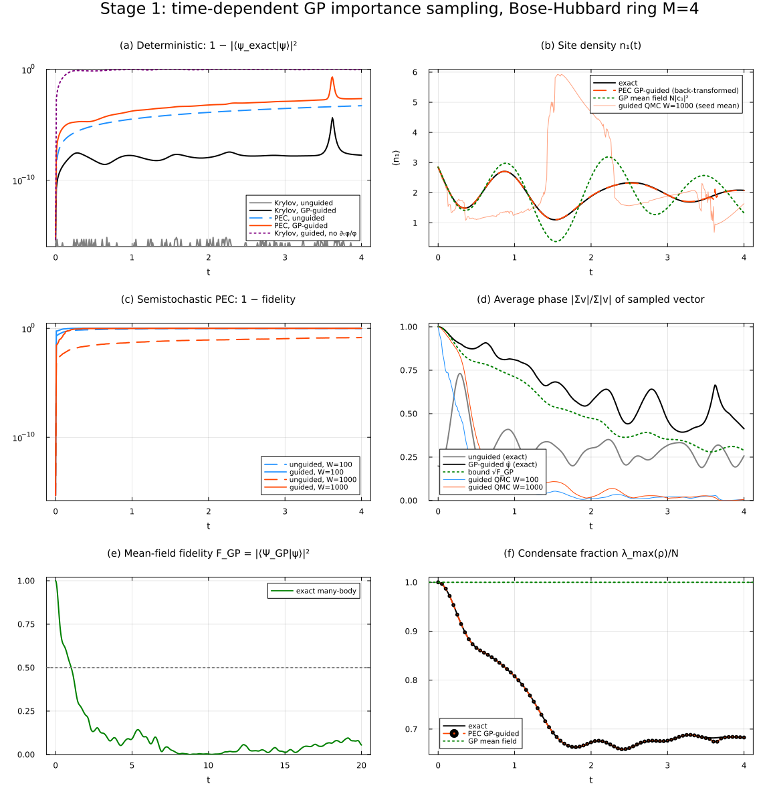
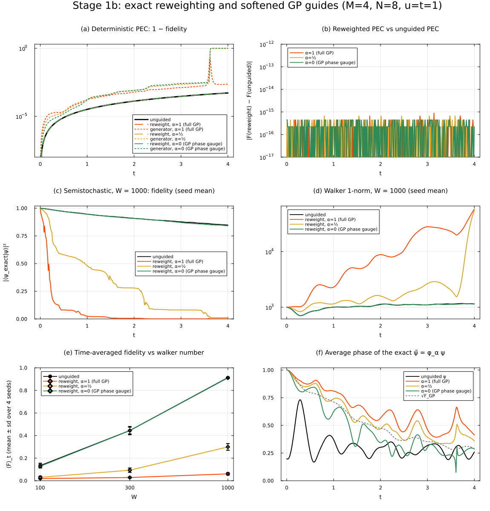
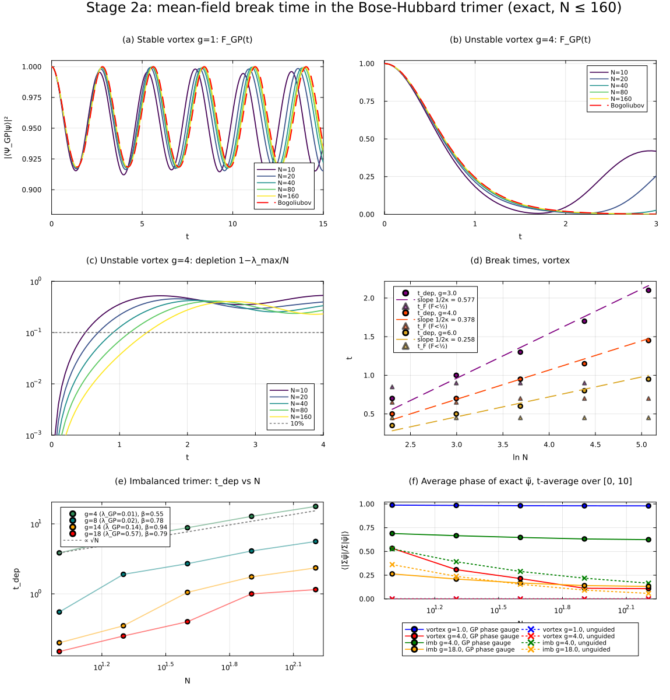
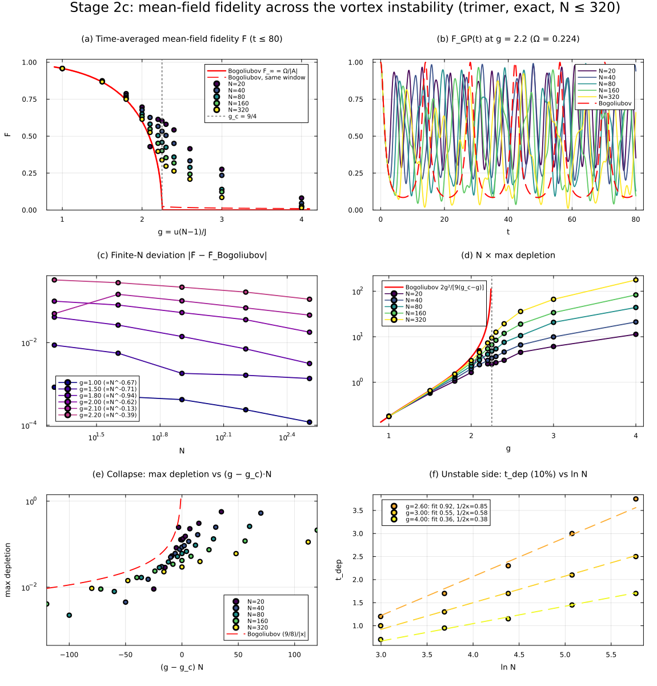
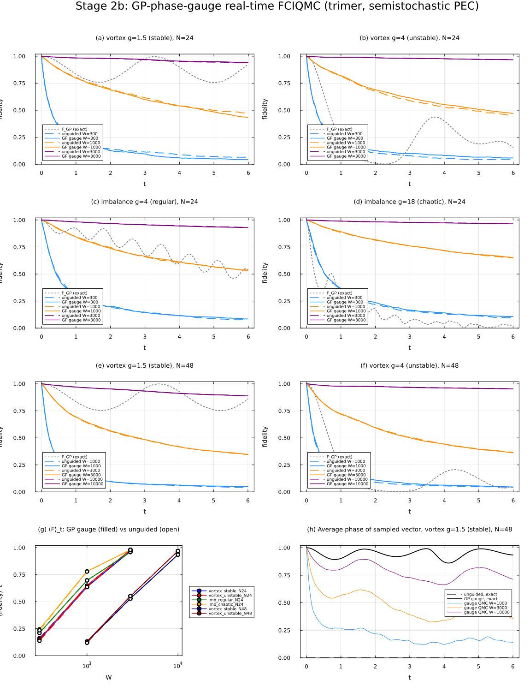

# Time-dependent Gross–Pitaevskii guiding in real-time FCIQMC — Stage 1 & 2 report

*2026-11-06 · RimuRealTime 0.1.0-DEV, Rimu 0.18.2, Gutzwiller 0.1.0, Julia 1.12.5 ·
all runs on ctcp through SLURM, plots made locally.*

Theory starting point: `ideation.tex` Eqs. (5) and (9). With a guide φ(x,t) and ψ̃ = φψ,

  ∂ₜψ̃ = [∂ₜφ/φ − iH̃(t)] ψ̃,  H̃ₓᵧ = φ(x,t)/φ(y,t) Hₓᵧ.

The guide is Gutzwiller.jl's `GrossPitaevskiiAnsatz`,
⟨n|Ψ_GP⟩ = √(N!/∏nₘ!) ∏ cₘ^{nₘ}, made time-dependent by evolving the orbital with the
discrete GP (Dirac–Frenkel/Hartree) equation iċ = h₁c + U(N−1)|c|²c.

---

## Headline results

1. **Working time-dependent similarity transform for RimuRealTime** (`scripts/GPGuidedDynamics.jl`).
   A `ModifiedHamiltonian` reads a mutable GP orbital while the simulation runs. Guided
   Krylov dynamics reproduces exact diagonalisation (1 − F ≤ 4×10⁻⁵, final 2×10⁻⁸).
   Dropping the ∂ₜφ/φ term of Eq. (5) gives F = 0.04, so the term is essential.
2. **Exact reweighting form of Eq. (5).** Because D e^{−iH dt} D⁻¹ = e^{−iH̃ dt} with
   D = diag φ, the transformed dynamics integrates *without splitting error* as
   "evolve with frozen H̃(tₙ), then multiply walkers by φ(tₙ₊₁)/φ(tₙ)". Reweighted PEC
   reproduces unguided PEC to ≤ 9×10⁻¹⁶ for every guide. The direct generator form
   (∂ₜφ/φ on the diagonal) is stiff: θ̇ ∝ 1/|cₘ| blows up when the GP orbital passes near
   a node, and explicit PEC then fails (F = 0.795 → 0.001).
3. **Magnitude importance sampling fails in real time.** Guides φ_α = |Ψ_GP|^α e^{−iθ_GP}
   with α > 0 (including the full φ = Ψ_GP*, α = 1) make the semistochastic walker
   population explode (1-norm ×10²–10⁵, fidelity → 0) at every W tested. Walker density
   ∝ |ψ|^{1+α} starves the tails, and the guide update amplifies the rounding noise there.
   Only the pure GP-phase gauge (α = 0, unitary, H̃ Hermitian) is stable.
4. **Mean-field breakdown has three exact scaling regimes** (Bose–Hubbard trimer, exact
   dynamics up to N = 160–320, fixed g = U(N−1)/J). The depletion break time scales as:
   - **Bogoliubov-stable superflow:** never breaks; depletion ∝ 1/N.
   - **Dynamically unstable superflow:** t_dep ≈ ln N/(2κ); fitted slopes are within
     ≈12–15% of Bogoliubov.
   - **Regular Josephson dynamics:** t_dep ∝ N^0.55 ≈ √N.
   - **Chaotic GP dynamics** (λ_GP ≈ 0.6): fastest breakdown, but the N-dependence at
     N ≤ 160 can't distinguish logarithmic from weak power-law scaling.

   The **mean-field fidelity** F_GP = |⟨Ψ_GP(t)|ψ(t)⟩|² breaks on an **N-independent**
   time in all regimes.
5. **The time-averaged mean-field fidelity is an order parameter for the dynamical
   instability.** For the trimer vortex, two-mode Bogoliubov theory gives *exactly*
   Ω² = g_c − g (g_c = 9/4). Hence F̄_∞ = √(g_c − g)/(3/2 − g/3), exponent ½, and the
   peak depletion number 2g²/[9(g_c − g)], exponent −1. Exact many-body data converge to
   both, with finite-N rounding in (g − g_c)N. *(Stage 2c; see below.)*
6. **The GP phase gauge removes the phase structure of the sampled vector but does not
   improve FCIQMC accuracy.** Average phase goes 0.006 → 0.79 (stable vortex, N = 48,
   W = 10⁴), but the fidelity is unchanged within seed error in all 18 case/W
   combinations. The semistochastic real-time FCIQMC fidelity is instead a **single
   function of W/D** (walkers per Hilbert-space state). That curve is the same for stable,
   unstable, regular and chaotic dynamics and for both gauges: ⟨F⟩ ≈ 0.13–0.24 at
   W/D ≈ 0.9, ≈ 0.55–0.78 at W/D ≈ 3, and ≈ 0.94–0.98 at W/D ≈ 9. At these sizes the
   limiting factor is sampling density, not a regime-dependent phase problem.
   *(Stage 2b.)*
7. **PEC accuracy rule for real-time FCIQMC.** PEC amplifies a mode of frequency ω by
   (1 + x⁴/4)^{1/2} per step (x = ω dt). Use S = ⟨H⟩ of the initial state and
   max|E − S| dt ≤ 0.1. The rule |E − S| dt ≤ 0.3 with S at the spectral centre gave
   O(1) deterministic errors, e.g. F = 0.001 for the chaotic case (data kept in
   `data/stage2b_qmc_dtcoarse`).

---

## Stage 1 — method and verification

### Implementation (`scripts/GPGuidedDynamics.jl`)

| piece | what it does |
|---|---|
| `GPOrbital` | mutable orbital c(t), RK4 (sub-steps ≤ 10⁻³) for iċ = h₁c + U(N−1)\|c\|²c; caches ċ/c |
| `TDGPGuided(H, gp; alpha, dt_term)` | `ModifiedHamiltonian{ComplexF64}`: H̃ₓᵧ = φ_α(x)/φ_α(y) Hₓᵧ using `GrossPitaevskiiAnsatz`; diagonal + i∂ₜlog φ_α if `dt_term` |
| `reweight!` | exact guide update ψ̃ ← φ(tₙ₊₁)/φ(tₙ) ψ̃ (applied to the state and to PEC's stored H·w) |
| `run_lockstep!` | steps several RimuRealTime simulations together and measures back-transformed observables against exact diagonalisation |
| `check_gp_consistency` | asserts ⟨Ψ_GP\|H\|Ψ_GP⟩ (Rimu) = N c†h₁c + (U/2)N(N−1)Σ\|c\|⁴ (passes to 10⁻¹²) |

Gutzwiller's own `AnsatzSampling` couldn't be used directly. Its parameters are an
immutable `SVector`, and it inherits `IsHermitian` from the parent Hamiltonian, which
would make RimuRealTime's Krylov step use Lanczos on a non-Hermitian H̃.

### Stage 1 (`stage1_verify.jl`, job 52495) — 4-site ring, N = 8 (dim 165), u = t = 1, generic complex GP initial state, φ = Ψ_GP*



* Krylov, guided: max(1 − F) = 4.3×10⁻⁵ (at the GP near-node t = 3.62), 1.8×10⁻⁸ at t = 4.
* Without the ∂ₜφ/φ term: 1 − F = 0.96.
* Bound **sign(ψ̃) ≥ √F_GP** (Cauchy–Schwarz: |Σ Ψ*ψ| / Σ|Ψ||ψ| ≥ |⟨Ψ|ψ⟩|) holds at all times.
* Explicit PEC with the generator form dips to F = 0.795 at the near-node (N|c₄|² = 0.002).
* Semistochastic with φ = Ψ*: 1-norm explodes from t ≈ 0.55 (10⁷–10¹¹), F → 0.

### Stage 1b (`stage1b_alpha.jl`, job 52509) — fix and diagnose



| W | unguided ⟨F⟩ | α = 0 (phase gauge) | α = ½ | α = 1 |
|---|---|---|---|---|
| 100 | 0.135 ± 0.020 | 0.129 ± 0.015 | 0.030 ± 0.011 | 0.020 ± 0.003 |
| 300 | 0.445 ± 0.030 | 0.444 ± 0.036 | 0.094 ± 0.019 | 0.029 ± 0.005 |
| 1000 | 0.914 ± 0.006 | 0.911 ± 0.006 | 0.300 ± 0.029 | 0.061 ± 0.011 |

(time-averaged fidelity over t ≤ 4, 4 seeds; max 1-norm for α > 0 reaches 10⁴–10⁵ vs ≈10³)

---

## Stage 2 — physics

### Model and why

Bose–Hubbard rings (`HubbardReal1D`), mostly the trimer M = 3. They're small enough for
exact dynamics up to N = 320 (dim 51 681), and their GP dynamics covers every regime:
stable, dynamically unstable and chaotic. The initial state is always a GP product state
(prepared condensate), at fixed g = U(N−1)/J (mean-field limit N → ∞).
* **Vortex (superflow):** cⱼ = e^{2πij/3}/√3, i.e. all bosons at k₀ = 2π/3. GP-stationary,
  Bogoliubov-unstable for g > 9/4.
* **Imbalance (Josephson):** c ∝ (√0.6, √0.3, √0.1). λ_GP ≈ 0.015 (g = 4) … 0.57 (g = 18),
  from the GP Lyapunov scan `stage2_gp_scan.jl` (job 52499).

### Stage 2a (`stage2a_breaktime.jl`, job 52517)



| case | g | κ or λ | t_F (F_GP < ½) | t_dep (10 %) scaling | theory |
|---|---|---|---|---|---|
| vortex | 1, 2 | stable | never (F̄ = 0.958 at g = 1 for every N) | never; depletion ∝ 1/N | F̄ = Ω/\|A\| = 0.9583 |
| vortex | 3 | κ = 0.866 | 0.85–0.95 (N-indep.) | slope 0.505 per ln N | 1/2κ = 0.577 |
| vortex | 4 | κ = 1.323 | 0.65–0.70 | slope 0.339 | 0.378 |
| vortex | 6 | κ = 1.936 | 0.45 | slope 0.216 | 0.258 |
| imbalance | 4 | λ_GP = 0.015 | 5.4–5.5 | ∝ N^0.55 | √N (regular dephasing) |
| imbalance | 8 | 0.020 | 1.85 | ∝ N^0.78 | — |
| imbalance | 14, 18 | 0.14, 0.57 | 0.40, 0.25 | irregular, t_dep ≤ 2.4 | ln N/λ not resolved at N ≤ 160 |
| 4-site π-state | 1, 3 | stable | never; F̄ = 0.988, 0.77 for all N | never | — |

Two points from this table:
* **Fidelity vs. observables.** F_GP measures whether there are O(1) Bogoliubov
  quasiparticles, so it breaks at an N-independent time (∝ 1/κ). Observables like the
  depletion fraction need O(εN) quasiparticles, which takes ∝ ln N/(2κ) when unstable.
  "Mean-field breakdown" therefore has two distinct times. The guided-QMC sign bound
  √F_GP tracks the first.
* In the exact state, the GP phase gauge raises the average phase from ≈ 0 to 0.98
  (stable vortex) and from 0.17–0.53 to 0.62–0.69 (regular imbalance). For the chaotic
  and unstable cases it decays with N (panel f).

### Stage 2c (`stage2c_threshold.jl`, job 52525) — across the vortex instability, N ≤ 320



Two-mode Bogoliubov for the trimer vortex (pair channel k₀ ± 2π/3 = {0, −2π/3}):
A = −3/2 + g/3, B = g/3, so **Ω² = A² − B² = 9/4 − g** exactly. This gives:

* F(t) = 1/[1 + (B/Ω)² sin²Ωt],  **F̄_∞ = √(g_c − g)/(3/2 − g/3)** → 0 with exponent ½;
* peak depletion number **N·d_max = 2g²/[9(g_c − g)]** → ∞ with exponent −1;
* above g_c: growth rate κ = √(g − g_c), t_dep ≈ ln N/(2κ).

| g | F̄ exact, N = 20 → 320 | Bogoliubov F̄ (same window) |
|---|---|---|
| 1.0 | 0.9575, 0.9579, 0.9579, 0.9581, 0.9582 | 0.9584 |
| 1.5 | 0.8751, 0.8720, 0.8682, 0.8680, 0.8678 | 0.8664 |
| 1.8 | 0.7879, 0.7731, 0.7607, 0.7537, 0.7498 | 0.7466 |
| 2.0 | 0.697, 0.678, 0.650, 0.632, 0.614 | 0.597 |
| 2.2 | 0.614, 0.566, 0.504, 0.452, 0.397 | 0.285 |
| 2.25 (g_c) | 0.603, 0.533, 0.458, 0.401, 0.339 | 0.026 |
| 3.0 | 0.276, 0.235, 0.140, 0.123, 0.085 | 0.013 |

* **Stable side:** exact F̄ converges to Bogoliubov, |ΔF̄| ∝ N^{−0.6…−0.9}. N × peak
  depletion collapses onto 2g²/[9(g_c − g)] for g ≤ 2 and is rounded near g_c. On the
  stable side, the depletion for different N roughly collapses as a function of
  (g − g_c)N (panel e), which points to a crossover window |g − g_c| ~ 1/N.
* **Unstable side:** t_dep vs ln N has slopes 0.92 / 0.55 / 0.36 vs 1/(2κ) = 0.85 / 0.58 /
  0.38 (g = 2.6 / 3 / 4). F̄ does **not** drop to the Bogoliubov value ≈ 0 at accessible
  N. Instead it decreases slowly with N (0.28 → 0.085 at g = 3). The exact dynamics shows
  repeated partial revivals toward the vortex (panel b), which linear Bogoliubov theory
  can't capture. That's the nonlinear return of the separatrix motion, with a chaotic
  layer, since λ_GP ≈ 0.2 for the perturbed vortex at g = 3.

### Stage 2b (`stage2b_qmc.jl`, job 52543) — GP phase gauge vs unguided FCIQMC



Semistochastic PEC (`IsDynamicSemistochastic{ComplexF64}`), 3 seeds, t ≤ 6, fidelity vs
exact diagonalisation. Deterministic PEC with the corrected dt has F ≥ 0.9975 in all
cases, so the losses below are stochastic.

| case (D) | W | ⟨F⟩ gauge | ⟨F⟩ unguided | ⟨phase⟩ gauge | ⟨phase⟩ unguided |
|---|---|---|---|---|---|
| vortex stable N=24 (325) | 1000 | 0.636 ± 0.012 | 0.646 ± 0.002 | 0.66 | 0.025 |
| vortex stable N=24 | 3000 | 0.968 ± 0.001 | 0.965 ± 0.002 | 0.91 | 0.006 |
| vortex unstable N=24 | 1000 | 0.650 ± 0.011 | 0.635 ± 0.007 | 0.26 | 0.030 |
| imbalance regular N=24 | 1000 | 0.697 ± 0.008 | 0.697 ± 0.010 | 0.47 | 0.22 |
| imbalance chaotic N=24 | 1000 | 0.781 ± 0.010 | 0.779 ± 0.002 | 0.20 | 0.17 |
| vortex stable N=48 (1225) | 10000 | 0.935 ± 0.001 | 0.935 ± 0.001 | 0.79 | 0.006 |
| vortex unstable N=48 | 10000 | 0.969 ± 0.001 | 0.970 ± 0.001 | 0.21 | 0.004 |

(full table: `stage2b_summary.txt`; the coarse-dt first run is `stage2b_qmc_dtcoarse.png`
and `stage2b_summary_dtcoarse.txt`, and its conclusions about the gauge are the same.)

**Why the gauge doesn't help here.** The gauge transform is a diagonal unitary, so
|ψ̃ₓ| = |ψₓ| and every spawning magnitude is unchanged. Only the complex phase of each
amplitude changes. Rounding noise in Rimu's semistochastic scheme depends on the phase of
a complex amplitude by at most a factor ≈ 2 (real and imaginary parts are rounded
separately), and that's too small to show. A gain would need a guide that changes *which*
configurations hold walkers, i.e. magnitude importance sampling. Finding 3 shows that is
unstable in real time unless the noise in the tails is controlled.

---

## Assessment: what looks new and publishable

1. **Methods note: "Time-dependent importance sampling for real-time projector QMC".**
   The new results are the exact reweighting identity, the stiffness of the generator form
   near guide near-nodes, and the instability of magnitude guiding in real time with its
   mechanism (tail starvation × guide amplification). These are concrete and reproducible,
   and they directly answer the open question in `ideation.tex`. Phase-only guiding is
   stable, but at these sizes it doesn't beat unguided sampling.
2. **Physics note: mean-field fidelity as an order parameter for the dynamical instability
   of superflow in a Bose–Hubbard ring.** The exact identity Ω² = g_c − g in the trimer
   gives closed forms: F̄ ∝ (g_c − g)^{1/2}, N·d_max ∝ (g_c − g)^{−1}, and
   t_dep ≈ ln N/(2√(g − g_c)). Exact many-body data up to N = 320 support all three, with
   the finite-N crossover in (g − g_c)N. The two distinct break times (fidelity: N-free;
   observables: ln N or √N) are a clean, testable statement for small-ring atomtronics
   experiments.
3. **Practical result for RimuRealTime users:** the PEC time-step rule above, and the
   observation that FCIQMC fidelity collapses in W/D across dynamical regimes.

**Caveats / to check before writing up.** Related literature needs a careful search:
superflow stability in Bose–Hubbard rings (e.g. Arwas & Cohen), beyond-mean-field break
times in double/triple wells (Vardi & Anglin; Kolovsky; Trimborn, Witthaut & Korsch), and
truncated-Wigner studies of current decay (Polkovnikov et al.). The order-parameter
framing and the guided-QMC side are what I believe to be new. The chaotic-regime N-scaling
is not resolved at N ≤ 160. All QMC comparisons are at D ≤ 1225, where W ≳ D is
affordable, so the regime where a guide could matter (W ≪ D) is still untested.

## Suggested next steps

* Test the W ≪ D regime (M = 5–6 rings, D ~ 10⁴–10⁵) with initiators, where
  regime-dependent phase problems should appear, and where a guide that changes *which*
  configurations are sampled might pay off.
* Stabilise magnitude guiding: cap the reweighting factor, or use a *mixed* estimator
  ⟨Ψ_GP|O|ψ⟩ / ⟨Ψ_GP|ψ⟩ that never divides by φ (an extrapolated estimator
  2⟨O⟩_mix − ⟨O⟩_GP is second-order accurate while F_GP is high).
* Real-time fixed-phase approximation (the objective in `ideation.tex`). McLachlan
  projection onto ψ = r e^{iθ_GP} with r real gives ṙ = A r with
  A_xy = H_xy sin(θ_y − θ_x). A is real antisymmetric, so ‖r‖ is conserved and the
  ∂ₜθ term drops out. Cheap to test deterministically against the exact data above.
* Extend Stage 2c to the 4-site ring vortex (marginal, ε̄ = 0) and to a flux-threaded
  ring, where g_c can be tuned through zero.

## Reproduce

```
# on ctcp (all through SLURM)
cd ~/claude/importance/runs
sbatch ~/claude/slurm_claude/submit.sl stage1_verify.jl      # ~1 min
sbatch ~/claude/slurm_claude/submit.sl stage1b_alpha.jl      # ~1 min
sbatch ~/claude/slurm_claude/submit.sl stage2_gp_scan.jl     # ~10 min
sbatch ~/claude/slurm_claude/submit.sl stage2a_breaktime.jl  # ~10 min
sbatch ~/claude/slurm_claude/submit.sl stage2b_qmc.jl        # ~25 min
sbatch ~/claude/slurm_claude/submit.sl stage2c_threshold.jl  # ~40 min
# local, from the repo root, after copying ctcp:~/claude/importance/data/* to data/
julia --project=devrimu results/plot_stage1.jl   # and plot_stage1b / 2a / 2b / 2c
```
(Non-interactive ssh needs `module load slurm` and `~/.juliaup/bin` on PATH before `sbatch`.)
